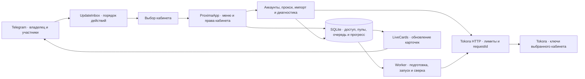

# Аккаунты, прокси и доступ в Proxima Soft

Один Telegram-бот обслуживает один или несколько кабинетов Tokora. У каждого кабинета своя очередь и база SQLite. Владелец назначает каждому участнику собственный пул аккаунтов. Бот сверяет этот пул с папкой в Tokora и отправляет идентификатор папки в запросе на запуск.

Владелец видит задачи сайта в разделе **Задачи Tokora**. Открытая карточка запрашивает прогресс примерно раз в пять секунд и показывает финальный результат после поздней проверки, если Tokora её объявила. Вкладка **Задачи из бота** показывает его локальные заказы, включая ещё не отправленные. При создании заказа владелец использует назначенный себе пул, если он есть. В остальных случаях бот выбирает свободные аккаунты с активными сессиями из Tokora и показывает размер пула на экране подтверждения.

## Как подключить человека

1. Человек открывает бота и передаёт владельцу свой Telegram ID из `/myid`.
2. В панели владельца выбери **Выдать доступ**, введи ID и срок. В карточке участника можно настроить суточный лимит задач и лимит открытых заказов.
3. Открой **Аккаунты участника**. Импортируй его файл, назначь аккаунт по ID или выдай нужное число свободных аккаунтов с активной сессией. Существующее назначение можно снять после завершения связанных заказов.
4. Запусти **Проверить сессии** и посмотри результат. Участник видит свой пул и может проверять его самостоятельно раз в 15 минут.
5. Отзыв срока или блокировка останавливают новые запуски. В панели владельца остаётся управление уже принятыми Tokora задачами.

| Возможность | Участник | Владелец |
| --- | --- | --- |
| Аккаунты и CSV | Назначенный пул, публичные имена, состояние сессий | Весь кабинет и отдельные пулы с внутренними ID и назначениями |
| Проверки сессий | Назначенный пул при действующем доступе | Один аккаунт, любой назначенный пул или весь кабинет |
| Профиль и диагностика видео | Своя карточка аккаунта | Обновление профиля, чтение комментариев и ответов, подтверждаемый ручной лайк |
| Прокси | Сводка по своему пулу | Инвентарь, карточки, проверки, привязка и удаление свободных записей |
| Задачи | Создание и чтение своих заказов, управление доступными действиями | Все локальные заказы, ручная сверка и настройки команды |

## Как читать результаты

**Активная сессия** означает, что Tokora вернула статус `active` при последней проверке. Карточка показывает её дату, если API её вернул. Состояние публикаций вынесено отдельно: попытки, ошибки, модерация, ожидание и пауза по данным `publicationHealth`.

**Проверка пула** вызывает индивидуальный endpoint для каждого назначенного аккаунта. Она пропускает занятые или отвязанные аккаунты. При отзыве доступа оставшиеся запросы прекращаются. Прогресс и итог хранятся в SQLite без содержимого сессии.

**Проверка кабинета** использует общую проверку Tokora. Пока бот видит её в работе или не подтвердил результат запуска, очередь удерживает новые заказы. Если произошёл сетевой сбой, открой статус проверки перед повтором.

**Подготовка заказа** сверяет доступ и назначения, читает последние статусы сессий и выбирает активные. SQLite повторно проверяет назначение и состояние обслуживания перед первым запросом. Бот сохраняет точное тело и `requestId` для сверки неопределённого запуска.

## Операции и способы запуска

| Tokora API | Где работать |
| --- | --- |
| `GET /v1/accounts`, `GET /v1/accounts/{id}` | Аккаунты, поиск, фильтры, карточки, CSV |
| `POST /v1/accounts/import` | Файл с назначением через карточку участника или серверную CLI |
| `POST /v1/accounts/import/file` | Серверная CLI без получателя. Tokora возвращает ID задачи импорта |
| `GET/POST/DELETE /v1/accounts/check` | Проверка кабинета, живой прогресс и подтверждаемая остановка |
| `POST /v1/accounts/{id}/check` | Карточка владельца и проверка назначенного пула |
| `POST /v1/accounts/{id}/profile/refresh` | Карточка владельца |
| `PUT /v1/accounts/{id}/proxy` | Выбор или снятие привязки по ID в карточке аккаунта |
| `GET …/comments`, `GET …/replies`, `PUT …/like` | Диагностика видео в карточке владельца, листание по курсору, подтверждение лайка или его снятия |
| `DELETE /v1/accounts/{id}` | Карточка владельца после отвязки и подтверждения |
| `POST /v1/accounts/purge` | Серверная `purge-accounts` с подтверждением и проверкой пустых очередей и назначений |
| `GET /v1/proxies` | Инвентарь и карточки. Управляемый пул может быть представлен общим числом линий без отдельных ID |
| `POST /v1/proxies`, `PATCH /v1/proxies/{id}` | Импорт или замена реквизитов из локального файла через CLI |
| `GET/POST/DELETE /v1/proxies/check` | Прогресс, проверка всех или выбранных записей, остановка |
| `DELETE /v1/proxies` | Подтверждаемое удаление по ID, когда бот может проверить отсутствие привязок |
| `POST /v1/tasks` и чтение состояния | Очередь, карточки и результаты в Telegram |

CSV содержит данные инвентаря и статусы. Для восстановления сессий используй исходные файлы: в OpenAPI нет операции выгрузки cookies. Для файлов с данными входа предпочтительна серверная CLI. Пакетный импорт с назначением разбирает JSON, TXT, ZIP, TAR и GZIP, получает подтверждённый ID каждой записи и сохраняет существующее назначение при конфликте. Tokora может обновить уже существующую сессию при повторном импорте cookies.

CLI должна использовать тот же `DATABASE_PATH`, что и бот. Посмотри список команд через `python -m proxima_bot.manage --help`. Если прокси скрыт или его привязку невозможно однозначно сопоставить по ответам API, открой карточку в кабинете Tokora. Ключи и реквизиты держи на сервере.

Бот проверяет состояние каждой записи задач при чтении `active=true`. На рабочем API этот фильтр также возвращал завершённые задачи, в том числе `completed_with_errors`. Такие записи доступны в отчётах, а очередь учитывает задачи, которые ещё выполняются или могут выполняться.

## Ключи и кабинеты

По приложенному OpenAPI лимит составляет **120 запросов в минуту на ключ и 600 на кабинет**. Бот распределяет запросы между включёнными ключами кабинета. Локальные лимиты составляют 110 запросов на ключ, 90 фоновых запросов на ключ и 590 запросов суммарно на кабинет за скользящую минуту.

Для начала достаточно выделенного ключа бота. Права ядра: `tasks:read/write`, `accounts:read/write` и `proxies:read/write`. Для диагностики видео нужны `videos:read/write`. `posts:read` нужен для проверки очереди перед изменениями прокси и очисткой кабинета. Права на публикации, материалы и настройки добавляй для используемых разделов. `/health` проверяет чтение и показывает последний ID ошибки Tokora для поддержки.

1. Открой **/admin → Кабинеты и ключи**. В выбранном кабинете нажми **Добавить ключ** и вставь ключ одним сообщением. Бот проверяет права чтения задач и папок, удаляет сообщение с ключом и сохраняет ключ в зашифрованном виде.
2. Бот сверяет ключи по папкам и точным ID задач. Первый кабинет можно подключить пустым. Для подключения независимого кабинета нужна хотя бы одна папка или задача, по которой бот сможет подтвердить различие. Для добавления ключа в уже подключённый кабинет нужен общий объект. Если объектов нет, создай папку на сайте и повтори подключение.
3. Чтобы добавить независимый кабинет, нажми **Добавить кабинет**, укажи название и подключи его первый ключ. **Открыть админку кабинета** переключает очереди, аккаунты, прокси и материалы. Уже принятые заявки остаются в своих кабинетах.
4. Нажми **Подключить трафера**, введи Telegram ID по подсказке, затем выдай доступ и назначь аккаунты в админке выбранного кабинета. Трафер открывает этот пул через `/workspaces`. Черновики, подписки и результаты хранятся по кабинетам.

У Tokora два слота задач на кабинет. Дополнительные ключи делят эти слоты. Два независимых кабинета дают до четырёх одновременных задач при доступных пулах и активных подписках. Задача закрепляется за кабинетом, выбранным при её оформлении. Это позволяет использовать исходные папку, материалы и результаты сбора.

После обновления бот сверяет ранее подключённые кабинеты перед отправкой новых заказов. Статусы уже запущенных задач обновляются во время сверки. Если кнопка со старого экрана просит открыть текущий пул, открой нужный кабинет через `/workspaces` и заново перейди к действию.

Сохраняй резервную копию основной базы, отдельных SQLite кабинетов и файла `<DATABASE_PATH>.keys`. Последний нужен для расшифровки ключей, доступ к нему предоставляется серверному оператору. CLI использует сохранённые ключи и принимает параметр `--workspace КОД` перед названием команды.

## Операции вне бота

| Где | Действия |
| --- | --- |
| Сайт Tokora | Оплата и продление подписки кабинета, рефералка, покупка прокси, выпуск и отзыв ключей Tokora и изменение их прав, создание и переименование папок, перенос аккаунтов между папками, расписания, которые выполняет сама Tokora. |
| Серверная CLI | Импорт и замена реквизитов своих прокси, массовая очистка аккаунтов, импорт файла без получателя и некоторые сырые выгрузки и операции OpenAPI. Список доступен через `python -m proxima_bot.manage api-list`. |
| OpenAPI не предоставляет | Выгрузку cookies и отдельный ID или остаток трафика конкретного купленного прокси Tokora. В боте доступен суммарный баланс прокси кабинета. |

## Карта проекта

| Файлы | Ответственность |
| --- | --- |
| `__main__.py`, `updates.py`, `bot.py`, `extended.py` | Старт сервисов, приватные Telegram-команды, навигация |
| `admin_panel.py`, `account_console.py`, `proxy_console.py` | Выдача доступа, инвентарь и действия владельца |
| `accounts.py`, `account_checks.py`, `live_cards.py` | Состояния сессий, проверка пула и кабинета, прогресс |
| `imports.py`, `account_import_ui.py`, `export_parts.py`, `manage.py` | Импорт, временные выгрузки и серверная CLI |
| `db.py`, `advanced_db.py`, `worker.py` | Назначения, блокировки обслуживания, состояние заказов и безопасные повторы |
| `api.py`, `operations.py`, `docs/tokora-openapi.json` | Транспорт, лимиты, правила доступа к маршрутам и контракт провайдера |

Служебные блокировки действуют в боте и CLI, использующих одну SQLite. Если меняешь прокси, сессии или задачи напрямую в кабинете, учитывай работающие заказы бота и синхронизируй операции через панель владельца.
